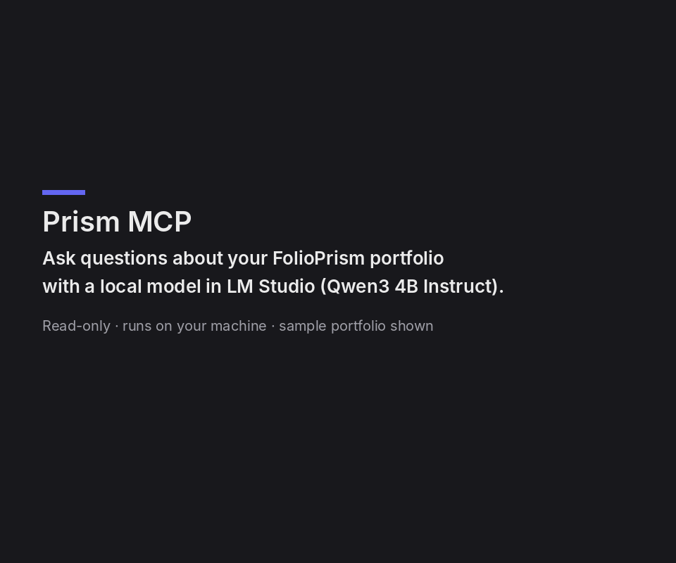

# Prism MCP

A read-only MCP server (stdio) that lets an AI assistant answer questions about your own Prism apps: [FolioPrism](https://github.com/SM4527/folioprism) (portfolio analysis) and [SignalPrism](https://github.com/SM4527/signalprism) (insider purchases from SEC Form 4 filings). It runs on your machine and only talks to loopback addresses.

A personal analysis tool, not investment advice. Data comes from your own FolioPrism and SignalPrism instances.

**Tech stack.** Node 24+, TypeScript 6, the v1 MCP TypeScript SDK (`@modelcontextprotocol/sdk`, stdio transport), zod, decimal.js and Vitest. It connects to a local FolioPrism instance (sample stack on `127.0.0.1:8420`) and/or a local SignalPrism instance (sample stack on `127.0.0.1:8500`).



*Sample portfolio, Qwen3 4B Instruct in LM Studio*

| Tool | Answers |
|---|---|
| `prism_status` | Which apps are configured and reachable, sample or personal stack, enabled tools, detail level |
| `folioprism_summary` | Holdings with weights, top-10 look-through concentration, stale or unpriced tickers |
| `folioprism_prism_view` | Portfolio vs benchmark: allocation, style box, sectors, regions, valuation, fees, bonds |
| `folioprism_top_stocks` | Largest look-through stock exposures and which funds contribute |
| `folioprism_stock_exposure` | How much of the portfolio is in one stock, in total and through each fund |
| `folioprism_fund_overlap` | Stocks two held funds both own, with each fund's weight |
| `folioprism_data_quality` | Freshness and completeness of FolioPrism's data |
| `signalprism_recent` | Recent scored insider purchases from SEC Form 4 filings (off until enabled) |
| `signalprism_clusters` | Several insiders buying the same stock close together |
| `signalprism_ticker` | One stock's insider purchases over 12 months and its clusters |

## Example

Question: *Any insider buys in my holdings in the last 30 days?*

The model calls `signalprism_recent` with `days: 30` (and `heldOnly: true` on a stack that has holdings). Abridged answer, sample data:

```
as of 2026-11-27 11:50 ET
IRBR (IRONBRIDGE INDUSTRIAL CORP): Nakamura Ren, CEO, bought $12,000, +16%, on 2026-11-25, filed 2026-11-26, score 6
ACMR (ACME ROBOTICS CORP): Okafor Sam, DIRECTOR, bought $31,200, +60%, on 2026-11-16, filed 2026-11-17, score 8 [cluster]
ACMR (ACME ROBOTICS CORP): Okafor Sam, CFO, bought $20,000, +10%, on 2026-11-09, filed 2026-11-12, score 9 [cluster]
...
```

The sample stack holds no positions, so the holdings filter returns nothing there; the rows above are unfiltered. A local model (Qwen3 4B Instruct in LM Studio) handled the tool calls well.

## Run

```sh
npm install
npm run build
node dist/index.js
```

Try it by hand with `npx @modelcontextprotocol/inspector node dist/index.js`. For the command-line mode, put the server command after `--` so the Inspector does not take `--config` for itself: `npx @modelcontextprotocol/inspector --cli --method tools/call --tool-name prism_status -- node dist/index.js --config <path>`.

## Configure

Pass a JSON file shaped like `config.example.json` with `--config <path>` or the `PRISM_MCP_CONFIG` environment variable. If both are set, `--config` wins. Use an absolute path: clients do not control the working directory. Without either, the server uses the FolioPrism sample stack on `http://127.0.0.1:8420` at the `percent` detail level. Keep your own config outside the repo. A missing or invalid config file stops the server; it never falls back to defaults.

```json
{
  "detail": "percent",
  "apps": {
    "folioprism": {
      "enabled": true,
      "baseUrl": "http://127.0.0.1:8420",
      "tools": { "folioprism_top_stocks": false }
    },
    "signalprism": {
      "enabled": false,
      "baseUrl": "http://127.0.0.1:8500",
      "tools": {}
    }
  },
  "logDir": "~/.prism-mcp/logs"
}
```

- `detail`: `percent` (default) or `full`. Only the config file sets it, never the model.
- `apps.<app>.enabled` and `apps.<app>.tools`: every tool is on unless set to `false`. Turned-off tools are not listed at all. An unknown tool name stops the server.
- `logDir` (default `~/.prism-mcp/logs`): each call appends time, tool, arguments, result size, duration and ok to `calls.jsonl`. Results are never logged. It must be outside this folder.

## Privacy

**Where results go.** Whatever a tool returns goes into the AI model's conversation. With a local model (LM Studio) nothing leaves your machine. With a cloud app such as Claude Desktop, results go to that provider.

Small local models can add details that aren't in the tool's answer. Expand the tool result in your chat app to see exactly what came back.

**Detail levels.**

| Level | Tools return | Use with |
|---|---|---|
| `percent` (default) | Percentages, tickers and names. No dollar amounts, no portfolio total | Any client |
| `full` | Adds dollar values and the portfolio total | Local models only |

**Sample vs personal stack.** The default points at FolioPrism's sample stack on port 8420. Pointing at your personal stack (port 8430) is your own choice, made in your own config outside this repo. The server refuses any base URL that is not `127.0.0.1`, `localhost` or `[::1]`, and only sends GET requests.

`npm run privacy-scan` runs on pre-push (`.githooks/pre-push`) and blocks local config, env files and logs. `npm install` activates the hook through the `prepare` script; if you skipped it, run `git config core.hooksPath .githooks` once.

## FolioPrism

FolioPrism analyzes your portfolio, including look-through exposure across funds. It is on by default.

- Sample stack: `baseUrl` defaults to `http://127.0.0.1:8420`. Start FolioPrism's sample stack first.
- Tools: `folioprism_summary` (`mergeShareClasses`), `folioprism_prism_view` (`section`; all sections when omitted), `folioprism_top_stocks` (`limit`, 1-50), `folioprism_stock_exposure` (`ticker`), `folioprism_fund_overlap` (`fundA`, `fundB`, `limit`), `folioprism_data_quality` (no parameters). `prism_status` (no parameters) shows whether FolioPrism is reachable, sample or personal, and which tools are enabled.
- At `percent` detail, results hold percentages, tickers and names only. At `full` (set in your config file, never by the model) they add dollar values (`valueUsd`, the yearly fee in `folioprism_prism_view`) and the portfolio total (`totalUsd` in `folioprism_summary`).
- Same guards as SignalPrism: loopback only, GET only, per-tool allowlist, calls logged without results.

## SignalPrism

SignalPrism tracks insider purchases from SEC Form 4 filings. It is off until you enable it in your config:

```json
{ "apps": { "signalprism": { "enabled": true } } }
```

- Sample stack: `baseUrl` defaults to `http://127.0.0.1:8500`. Start SignalPrism's sample stack first. Pointing at your personal stack (port 8510) is your own choice, made in your own config outside this repo.
- Tools: `signalprism_recent` (`days`, `minScore`, `role`, `heldOnly`, `includePlan`), `signalprism_clusters` (`days`), `signalprism_ticker` (`ticker`). Each answer starts with `as of <time>`. Plan buys (10b5-1, ESPP, DRIP, 401(k)) are left out unless `includePlan` is true.
- Same guards as FolioPrism: loopback only, GET only, per-tool allowlist, calls logged without results. `prism_status` shows whether SignalPrism is reachable, sample or personal, its last poll and whether polling is paused.
- Purchase values (`value_usd`) are public SEC data, so they are returned at `percent` detail too. The tools never return your own holdings amounts, only `held_via` (`direct`, `funds` or null).
- Research data, not investment advice.

## Setup: LM Studio (local, recommended for real data)

On Windows on ARM (Snapdragon X, 16 GB RAM):

1. Install the ARM64 build of [LM Studio](https://lmstudio.ai) (Windows on Snapdragon is supported; see Qualcomm's [LM Studio tutorial for Windows on Snapdragon](https://www.qualcomm.com/developer/blog/2025/02/how-to-run-deepseek-windows-snapdragon-tutorial-lmstudio)) and Node 24 for ARM64. `node -p process.arch` should print `arm64`.
2. Download a 4B model with tool-use support, for example a Qwen3 4B build. Check for the tool-use badge. Small models can be unreliable at tool calls; Gemma 3 4B may struggle.
3. Run `npm run build` and create your config outside the repo.
4. In the right sidebar open the Program tab (labelled Integration in newer versions), then Install, then Edit mcp.json (`%USERPROFILE%\.lmstudio\mcp.json`). Add one of:

```json
{
  "mcpServers": {
    "prism": {
      "command": "node",
      "args": ["C:/Users/YOU/projects/prism-mcp/dist/index.js", "--config", "C:/Users/YOU/prism-config.json"]
    }
  }
}
```

```json
{
  "mcpServers": {
    "prism": {
      "command": "node",
      "args": ["C:/Users/YOU/projects/prism-mcp/dist/index.js"],
      "env": { "PRISM_MCP_CONFIG": "C:/Users/YOU/prism-config.json" }
    }
  }
}
```

Clients pass only the environment variables listed in their config, so `PRISM_MCP_CONFIG` must be set in `env`.

5. Load the model, enable the `prism` server, and ask it to call `prism_status`. Confirm the stack (sample or personal), the detail level and the enabled tools before asking real questions. LM Studio asks you to confirm each tool call.

## Setup: Claude Desktop (cloud)

Tool results go to Anthropic. Keep `detail` at `percent` and do not use `full`.

1. Build the server and create your config as above.
2. Open `claude_desktop_config.json` and add the same `mcpServers` entry as above, either variant. The packaged Windows install keeps it at `%LOCALAPPDATA%\Claude-Data\<package-id>\claude_desktop_config.json`, not `%APPDATA%\Claude`. The reliable way to find it: menu (≡), Help, Troubleshooting, Enable Developer Mode, then Settings, Developer, Edit Config.
3. Quit Claude Desktop completely and restart it.
4. Ask Claude to call `prism_status` and confirm the stack and detail level before asking real questions.

Tested on Windows on ARM (Snapdragon X): Claude Desktop ran as native ARM64 and `prism_status` worked against the sample stack.

## Troubleshooting

- Ask the assistant to call `prism_status` first. It shows the stack, detail level, enabled tools and whether each app is reachable.
- Confirm FolioPrism (`127.0.0.1:8420` for the sample stack) and SignalPrism (`127.0.0.1:8500`) are running and listening on loopback.
- Use an absolute path for `--config` or `PRISM_MCP_CONFIG`. A missing or invalid config stops the server.
- Check `~/.prism-mcp/logs/calls.jsonl` (or your `logDir`) to see which tools were called, with what arguments, and whether they succeeded.

## Development

`npm test`, `npm run lint`. Built on the v1 MCP TypeScript SDK (`@modelcontextprotocol/sdk`). Demo recording steps: `docs/demo-checklist.md`.

## Built with Claude Code

Plan, code and tests written in milestone sessions with Claude Code, each milestone reviewed before commit.

## License

[MIT](LICENSE)
